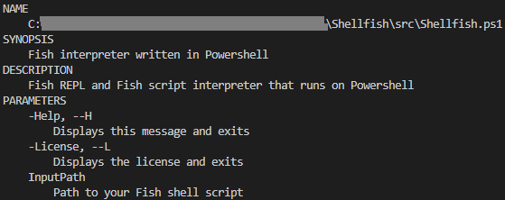

# Journal

## Journal #1 - Setup

### Time: 49 minutes

In this session, I setup the main base for the project- namely the main file, and all the basic input parameters. 

These are:

- Help
- License
- InputFile

This is my first time using PowerShell, so I referenced the [Microsoft PowerShell docs](https://learn.microsoft.com/en-us/powershell/scripting/developer/help/examples-of-comment-based-help?view=powershell-7.6) when designing the help message. I thought it would be interesting to try to jump right into the project (based on the maybe faulty rational that PowerShell can't be all that different from other language, right?), and so this session ahs taken me a bit longer than setup normally would. There were two main areas of syntax that I was surprised about. Firstly, using "-ne" for not equals. I tried a few not equals combinations before looking it up. The other was "elseif", I at first tried "else if" and "elif". I think I might have to be a bit faster on looking up basic syntax in future.

After getting over the syntax confusion, I implemented handling for Help and License parameters. I did switch from MIT to GPL 2.0 partway through, and had to replace my License printout, but I think this is for the best so I have the same license as the actual Fish shell.

Help output : 

