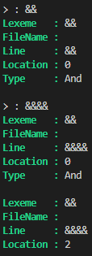

# Journal

### Total Time: 3hr 38min

---

## Journal #1 - Setup

### Time: 49 minutes

In this session, I setup the main base for the project- namely the main file, and all the basic input parameters. 

These are:

- Help
- License
- InputFile

This is my first time using PowerShell, so I referenced the [Microsoft PowerShell docs](https://learn.microsoft.com/en-us/powershell/scripting/developer/help/examples-of-comment-based-help?view=powershell-7.6) when designing the help message. I thought it would be interesting to try to jump right into the project (based on the maybe faulty rational that PowerShell can't be all that different from other language, right?), and so this session ahs taken me a bit longer than setup normally would. There were two main areas of syntax that I was surprised about. Firstly, using "-ne" for not equals. I tried a few not equals combinations before looking it up. The other was "elseif", I at first tried "else if" and "elif". I think I might have to be a bit faster on looking up basic syntax in future.

After getting over the syntax confusion, I implemented handling for Help and License parameters. I did switch from MIT to GPL 2.0 partway through, and had to replace my License printout, but I think this is for the best so I have the same license as the actual Fish shell.

Help output : 

## Journal 2 - Data Storage

### Time: 58 Minutes

In this session, I set up a module for holding data storage components. As PowerShell has the option to be object oriented, I decided to use a class for Token storage, and I decided to use an Enum for storing the possible token types. To figure out which token types I needed, I read through the [fish documentation](https://fishshell.com/docs/current/language.html#combining-different-expansions), a slightly tedious task, but at least it got me more familiar with the fish language. For token types that conflicted with PowerShell keywords, I tried a bunch of different options form a shortened form to appending "Block", but ended up with appending "Stmt" or "Expr" to the end of the type to differentiate it.

All of this is organized into a PowerShell module, so it hopefully will be useable in each system of the interpreter. For my modules, I'm basing the file organization on [this article](https://dev.to/playfulprogramming/how-to-write-better-powershell-scripts-architecture-and-best-practices-emh).

## Journal 3 - First Lexer Output

### Time: 1hr 51min

The Lexer is finally up and able to produce output. Currently all it can parse is single and double ampersands ("&" & "&&"), but it should be much faster add parsing for other tokens now that the infrastructure is setup.

The first step was setting up the Lexer module itself. After having setup the DataStorage module, this went fairly smoothly. The only major problems I had were with importing the DataStorage module. Firstly, I found that importing DataStorage by placing it into NestedModules in the manifest worked better than an import at the top of the file. The other problem once I had that figured out was that I forget to point the DataStorage module manifest to the actual DataStorage code (oops). 

Once that worked, I setup the main Lexer function, Get-Tokens. This function was originally Tokanize-String, but this required a verbose flag on import, as "Tokanize" is not part of the PowerShell approved verbs list, so I swapped it to an approved verb. This main function has a few steps. First, it splits the inputted code string into lines, and loops through them. Then, it loops until the State index reaches the end of the line. I'm not using a for loop for this so other functions that do parts of parsing can increment this index. For example, the function Test-Next tests if the next character matches the inputted one. If it does, the index is incremented and true is returned, otherwise false is returned. After parsing all the lines, the Lexer returns a List of Tokens which will eventually be passed into the Lexer. For now, the outputs are just being displayed to the screen.

One final note is that I'm using System.Collections.Generic.List to store tokens, not the default PowerShell array. PowerShell arrays have a fixed size upon creation, and I don't know how many tokens I will have, so I'm using the collection recommended by the [docs](https://learn.microsoft.com/en-us/powershell/scripting/learn/deep-dives/everything-about-arrays?view=powershell-7.6#generic-list).

